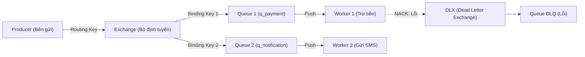

# BẢN TỔNG HỢP TOÀN DIỆN: RABBITMQ VS APACHE KAFKA
> **Tài liệu tham khảo chuyên sâu & hệ thống hóa kiến trúc phân tán**  
> *Dành cho báo cáo đồ án, phỏng vấn kỹ thuật (System Design) và áp dụng vào dự án thực tế.*

---

## MỤC LỤC
1. [Triết lý thiết kế cốt lõi (Core Philosophy)](#1-triết-lý-thiết-kế-cốt-lõi-core-philosophy)
2. [Mô hình 3 khối: Producer - Broker - Consumer](#2-mô-hình-3-khối-producer---broker---consumer)
   - 2.1 Bản chất 3 thành phần qua ví dụ đời thực
   - 2.2 Producer là gì? (Đoạn mã bắn tin nhắn vs Nơi lưu trữ API)
   - 2.3 5 hình thức Producer trong các hệ thống thực tế
   - 2.4 Tại sao Frontend (Client) không nên làm Producer trực tiếp?
   - 2.5 Ánh xạ trực tiếp vào mã nguồn dự án thực nghiệm
3. [Chi tiết Apache RabbitMQ](#3-chi-tiết-apache-rabbitmq)
   - 3.1 Các thành phần cốt lõi
   - 3.2 Các loại Exchange thông dụng
   - 3.3 Cơ chế hoạt động nội tại (Lifecycle của 1 tin nhắn)
   - 3.4 Cơ chế ACK, NACK và Dead Letter Queue (DLQ)
4. [Chi tiết Apache Kafka](#4-chi-tiết-apache-kafka)
   - 4.1 Các thành phần cốt lõi
   - 4.2 Cơ chế Partition & Append-Only Commit Log
   - 4.3 Cơ chế Consumer Group & Quản lý Offset (Replay)
   - 4.4 Cơ chế hoạt động nội tại (Lifecycle của 1 sự kiện)
5. [So sánh toàn diện: Điểm giống và Khác nhau](#5-so-sánh-toàn-diện-điểm-giống-và-khác-nhau)
   - 5.1 Điểm giống nhau
   - 5.2 Bảng so sánh 12 tiêu chí cốt lõi
6. [Ví dụ thực tế thực chiến (Hệ thống E-Commerce Shopee/Tiki)](#6-ví-dụ-thực-tế-thực-chiến-hệ-thống-e-commerce-shopeetiki)
7. [Cẩm nang lựa chọn: Khi nào dùng cái nào?](#7-cẩm-nang-lựa-chọn-khi-nào-dùng-cái-nào)

---

## 1. Triết lý thiết kế cốt lõi (Core Philosophy)

Trước khi đi vào từng thành phần, cần hiểu **triết lý cốt lõi** khiến hai hệ thống này đi theo hai hướng hoàn toàn khác nhau:

```
┌──────────────────────────────────────────────┐
│           RABBITMQ: "Smart Broker"           │
│        (Broker thông minh, Consumer đơn giản) │
└──────────────────────┬───────────────────────┘
                       │ Broker lo hết: lọc tin nhắn, định tuyến
                       │ theo luật phức tạp, theo dõi ai đã nhận việc,
                       │ tự động xóa tin nhắn trong RAM khi nhận ACK.
                       ▼
┌──────────────────────────────────────────────┐
│             KAFKA: "Dumb Broker"             │
│        (Broker tối giản, Consumer chủ động)  │
└──────────────────────────────────────────────┘
  Broker chỉ làm 1 việc duy nhất cực nhanh: Ghi nối đuôi vào đĩa cứng.
  Không quan tâm ai đã đọc hay chưa. Consumer tự nhớ vị trí (Offset)
  của mình và tự kéo dữ liệu theo tốc độ của mình.
```

---

## 2. Mô hình 3 khối: Producer - Broker - Consumer

Mọi hệ thống truyền tin nhắn phân tán (dù là RabbitMQ hay Kafka) đều được xây dựng dựa trên 3 khối kiến trúc nền tảng:

```
[ 1. PRODUCER ]              [ 2. BROKER ]             [ 3. CONSUMER ]
(Bên gửi tin)       ──▶   (Trạm trung chuyển)   ──▶   (Bên tiêu thụ / Worker)
```

### 2.1 Bản chất 3 thành phần qua ví dụ đời thực

Hãy liên hệ với **Công ty bưu chính chuyển phát nhanh**:
1. **PRODUCER (Người gửi hàng)**:
   - Là người đóng gói gói hàng và mang ra gửi tại bưu cục.
   - *Đặc điểm*: Người gửi **không cần biết** bưu tá nào sẽ giao, giao vào lúc mấy giờ hay đi bằng xe gì. Chỉ cần bưu cục nhận gói hàng là người gửi yên tâm quay về làm việc khác (Bất đồng bộ - Asynchronous).
2. **BROKER (Bưu cục trung tâm / Hệ thống điều phối & Kho bãi)**:
   - Chính là **RabbitMQ** hoặc **Apache Kafka**.
   - *Nhiệm vụ*: Nhận kiện hàng từ người gửi, phân loại hàng theo địa chỉ, lưu trữ an toàn trong kho, điều phối chia việc cho nhân viên giao hàng, đảm bảo không bị thất lạc hàng hóa.
3. **CONSUMER (Nhân viên giao hàng / Người nhận xử lý)**:
   - Là các **Worker / Service chạy ngầm**.
   - *Đặc điểm*: Nhận việc từ bưu cục về để thực hiện nhiệm vụ thực tế (giao hàng, thu tiền, gửi SMS). Xử lý xong thì báo cáo hoàn tất (ACK).

---

### 2.2 Producer là gì? (Đoạn mã bắn tin nhắn vs Nơi lưu trữ API)

> **Lưu ý quan trọng**: Producer **KHÔNG PHẢI** là "nơi lưu trữ API" (nơi lưu trữ API thường là API Gateway, Web Server hoặc tài liệu Swagger).

👉 **PRODUCER CHÍNH LÀ ĐOẠN CODE / SERVICE BACKEND THỰC HIỆN HÀNH ĐỘNG GỌI LỆNH `publish()` HOẶC `send()` ĐỂ ĐẨY TIN NHẮN VÀO BROKER.**

Khi khách hàng bấm nút trên ứng dụng, request HTTP gửi đến máy chủ Backend. Tại Controller Backend, lập trình viên viết:
```javascript
// Đoạn code này CHÍNH LÀ PRODUCER:
channel.publish('order_exchange', 'order_key', Buffer.from(JSON.stringify(orderData)));
producer.send({ topic: 'order-events', messages: [...] });
```

---

### 2.3 5 hình thức Producer trong các hệ thống thực tế

Trong các hệ thống phân tán quy mô lớn, Producer xuất hiện dưới 5 hình thái chủ yếu:

1. **Backend API Service (Phổ biến nhất - 80% trường hợp)**:
   - *Ví dụ*: `Order Service` của Shopee/Tiki. Khi khách hàng bấm "Thanh toán", App gọi API `POST /orders`. Backend nhận yêu cầu, kiểm tra dữ liệu sơ bộ rồi đóng gói tin nhắn bắn vào RabbitMQ/Kafka $\rightarrow$ **Backend Service đó chính là Producer.**
2. **Thiết bị phần cứng / Cảm biến IoT (Internet of Things)**:
   - *Ví dụ*: Cục định vị GPS gắn trên xe ôm công nghệ Grab/Gojek. Cứ mỗi **1 giây**, vi mạch GPS tự động kích hoạt kết nối mạng và bắn tọa độ *(Kinh độ, Vĩ độ, Vận tốc)* thẳng vào Kafka $\rightarrow$ **Cục phần cứng GPS trên xe chính là Producer.**
3. **Phần mềm thu thập Log hệ thống (Log Collectors)**:
   - *Ví dụ*: Filebeat, Fluentd, Vector cài đặt trên các máy chủ đám mây. Mỗi khi Nginx hoặc MySQL ghi thêm 1 dòng lỗi vào file log, công cụ này lập tức đọc dòng đó và bắn vào Kafka $\rightarrow$ **Phần mềm Filebeat chính là Producer.**
4. **Hệ thống chụp biến động dữ liệu Database (Change Data Capture - CDC)**:
   - *Ví dụ*: Công cụ Debezium cắm vào MySQL/PostgreSQL. Khi có bất kỳ câu lệnh `INSERT`, `UPDATE` hay `DELETE` trong bảng người dùng, Debezium tự động biến dòng dữ liệu thay đổi đó thành sự kiện và bắn vào Kafka $\rightarrow$ **Debezium là Producer.**
5. **Dịch vụ tiếp nhận Webhook từ đối tác (Webhook Receiver)**:
   - *Ví dụ*: Cổng thanh toán MoMo / VNPay gửi thông báo Webhook về máy chủ của bạn báo *"Khách đã quét mã trả tiền"*. Máy chủ của bạn nhận Webhook rồi bắn ngay vào RabbitMQ để xử lý cộng tiền ví $\rightarrow$ **Service nhận Webhook là Producer.**

---

### 2.4 Tại sao Frontend (Client) không nên làm Producer trực tiếp?

Một câu hỏi kinh điển khi bảo vệ đồ án hoặc phỏng vấn: *"Tại sao không cho ứng dụng Web React/Vue hoặc Mobile App kết nối thẳng vào RabbitMQ/Kafka để làm Producer?"*

* **Lý do 1: Bảo mật (Security)**: Nếu đưa cấu hình kết nối RabbitMQ/Kafka xuống Frontend, người dùng có thể mở DevTools để xem được tài khoản/mật khẩu của Broker.
* **Lý do 2: Tránh phá hoại & Spam dữ liệu**: Kẻ xấu có thể viết script giả mạo bắn hàng triệu tin nhắn rác thẳng vào Broker làm sập toàn bộ hệ thống.
* **Lý do 3: Tối ưu mạng (Network & Protocol)**: RabbitMQ (AMQP) và Kafka sử dụng giao thức nhị phân qua cổng TCP chuyên dụng, không phù hợp để mở cổng trực tiếp ra ngoài Internet công cộng.
* **Quy chuẩn bắt buộc**: Frontend luôn chỉ gọi HTTP/REST API an toàn $\rightarrow$ **Backend Server sẽ xác thực (Authentication), kiểm tra nghiệp vụ rồi mới đóng vai trò Producer bắn vào Broker.**

---

### 2.5 Ánh xạ trực tiếp vào mã nguồn dự án thực nghiệm

Trong dự án thực nghiệm bạn đang chạy tại thư mục `d:\chuyendektpm\demo`:

```
[ Giao diện Web / Client ]
           │ (Bấm nút Đặt Đơn)
           ▼ HTTP POST /api/orders
┌─────────────────────────────────────────────────────────────┐
│ 1. PRODUCER: File demo/src/controllers/orderController.js    │
│    - Nhận request từ Client                                 │
│    - Gọi publishOrder(orderData) (Bắn sang RabbitMQ)        │
│    - Gọi appendOrderLog(orderData) (Bắn sang Kafka)         │
└──────────────────────────────┬──────────────────────────────┘
                               │
               ┌───────────────┴───────────────┐
               ▼                               ▼
┌──────────────────────────────┐ ┌──────────────────────────────┐
│ 2A. BROKER: RabbitMQ         │ │ 2B. BROKER: Apache Kafka     │
│ - Lưu tạm trong RAM          │ │ - Lưu vĩnh viễn trên đĩa cứng│
│ - Exchange phân phối Queue:  │ │ - Commit Log: Partition 0    │
│   • q_payment                │ │ - Đánh số Offset 0, 1, 2...  │
│   • q_notification           │ │                              │
│   • q_dlq (Dead Letter Queue)│ │                              │
└──────────────┬───────────────┘ └──────────────┬───────────────┘
               │                                │
               ▼                                ▼
┌──────────────────────────────┐ ┌──────────────────────────────┐
│ 3A. CONSUMER: RabbitMQ Worker│ │ 3B. CONSUMER: Kafka Replay   │
│ - Payment Worker:            │ │ - Service Đối Soát Doanh Thu │
│   Rút đơn -> Trừ tiền ví     │ │ - Khi bấm Replay: Kéo Offset │
│   Đủ tiền: ACK (Xóa khỏi RAM)│ │   về 0 để đọc lại từ đầu trên│
│   Thiếu tiền: NACK (Vào DLQ) │ │   đĩa cứng và tính doanh thu │
│ - Notification Worker:       │ │                              │
│   Rút đơn -> Bắn SMS -> ACK  │ │                              │
└──────────────────────────────┘ └──────────────────────────────┘
```

---

## 3. Chi tiết Apache RabbitMQ

RabbitMQ là một **Message Broker truyền thống** tuân thủ theo chuẩn giao thức **AMQP 0-9-1** (Advanced Message Queuing Protocol). Mục tiêu chính: **Điều phối tác vụ (Task Queue)** giữa các dịch vụ một cách tin cậy và linh hoạt.

### 3.1 Các thành phần cốt lõi của RabbitMQ



1. **Producer (Publisher)**: Ứng dụng tạo và gửi tin nhắn (ví dụ: Service Đặt Hàng khi khách bấm mua).
2. **Exchange (Bộ định tuyến)**: 
   - Điểm tiếp nhận tin nhắn đầu tiên từ Producer.
   - **Quan trọng**: Trong RabbitMQ, Producer **không bao giờ** gửi tin nhắn thẳng vào Queue, mà bắt buộc phải gửi qua Exchange.
   - Exchange có nhiệm vụ kiểm tra header / routing key của tin nhắn để quyết định đẩy tin nhắn vào những Queue nào.
3. **Binding**: Mối liên kết (dây nối) giữa một Exchange và một Queue kèm theo một điều kiện lọc gọi là `Binding Key`.
4. **Routing Key**: Thẻ nhãn mà Producer đính kèm vào tin nhắn để Exchange biết đường định tuyến.
5. **Queue (Hàng đợi)**:
   - Nơi lưu trữ tạm thời các tin nhắn trong **bộ nhớ RAM** (có hỗ trợ backup xuống đĩa nếu cấu hình `durable: true`).
   - Hoạt động theo cơ chế hàng đợi FIFO (First In, First Out).
6. **Consumer (Worker)**:
   - Tiến trình / ứng dụng lắng nghe Queue để rút việc ra xử lý.
7. **Connection & Channel**:
   - `Connection`: Kết nối TCP thật giữa ứng dụng và RabbitMQ.
   - `Channel`: Một kết nối ảo (multiplexing) bên trong Connection, giúp tạo hàng trăm luồng xử lý nhẹ mà không tốn chi phí mở nhiều socket TCP.

---

### 3.2 Các loại Exchange thông dụng trong RabbitMQ

RabbitMQ có 4 loại Exchange chính giải quyết 4 bài toán định tuyến khác nhau:

| Loại Exchange | Cách hoạt động | Ví dụ thực tế |
| :--- | :--- | :--- |
| **Direct Exchange** | Khớp chính xác `Routing Key == Binding Key`. | Đơn hàng `vip` vào hàng đợi VIP, đơn `normal` vào hàng đợi Thường. |
| **Fanout Exchange** | Bỏ qua routing key, **sao chép tin nhắn gửi đến TẤT CẢ Queue** đang nối với nó (Publish/Subscribe). | Bấm đặt đơn $\rightarrow$ Gửi đồng thời cho [Queue Trừ Tiền] VÀ [Queue Gửi SMS]. |
| **Topic Exchange** | Khớp routing key theo mẫu ký tự đại diện (`*` khớp 1 từ, `#` khớp 0 hoặc nhiều từ). | `order.asia.vietnam` $\rightarrow$ Queue nghe `order.asia.*` hoặc `order.#`. |
| **Headers Exchange** | Không dùng routing key, định tuyến dựa trên các cặp key-value trong Header của tin nhắn. | Lọc tin nhắn dựa theo `format: pdf`, `priority: high`. |

---

### 3.3 Cơ chế hoạt động nội tại của RabbitMQ (Lifecycle của 1 tin nhắn)

1. **Bước 1: Gửi tin**: Producer tạo tin nhắn kèm `routing_key` và gửi tới Exchange.
2. **Bước 2: Định tuyến**: Exchange đối chiếu `routing_key` với các `binding_key` đã khai báo để phân phối bản sao tin nhắn vào các Queue tương ứng.
3. **Bước 3: Đẩy việc (Push)**: RabbitMQ chủ động đẩy tin nhắn cho các Consumer đang chờ (`channel.consume`).
4. **Bước 4: Xác nhận (ACK)**:
   - Worker nhận tin $\rightarrow$ Xử lý nghiệp vụ thành công $\rightarrow$ Gửi lệnh `channel.ack(msg)`.
   - **XÓA KHỎI RAM**: Ngay khi nhận được `ack`, RabbitMQ **xóa vĩnh viễn** tin nhắn này khỏi Queue để giải phóng RAM.

---

### 3.4 Cơ chế ACK, NACK và Dead Letter Queue (DLQ)

Đây là tính năng đắt giá nhất của RabbitMQ trong xử lý tác vụ nghiệp vụ:
- **ACK (Acknowledge)**: Báo tin nhắn xử lý xong, Broker xóa tin nhắn khỏi Queue.
- **NACK (Negative Acknowledge) hoặc Reject**:
  - Khi worker gặp lỗi (ví dụ: số dư ví không đủ, lỗi kết nối ngân hàng), worker gửi `nack(msg, requeue: false)`.
  - Thay vì làm mất tin nhắn hoặc bị treo vô tận, RabbitMQ sẽ tự động chuyển tin nhắn này sang một **Dead Letter Exchange (DLX)** để gom vào **Hàng đợi lỗi (DLQ)**.
  - Các kỹ sư hoặc đội CSKH có thể kiểm tra DLQ để hỗ trợ khách hoặc chạy script sửa lỗi.

---

## 4. Chi tiết Apache Kafka

Apache Kafka ban đầu được LinkedIn phát triển và sau đó chuyển giao cho Apache Software Foundation. Kafka không phải là một Message Broker thông thường, mà là một **Distributed Streaming Platform (Nền tảng luồng sự kiện phân tán)** hoạt động như một **Sổ cái sự kiện ghi nối đuôi (Distributed Commit Log)**.

### 4.1 Các thành phần cốt lõi của Kafka

```mermaid
flowchart TD
    P["Producer (Bên xuất bản sự kiện)"] -->|Ghi nối đuôi| TOPIC["Topic: order-events"]
    
    subgraph TOPIC["Topic: order-events (Lưu trên đĩa cứng)"]
        subgraph P0["Partition 0"]
            direction LR
            O0["Offset 0"] --> O1["Offset 1"] --> O2["Offset 2"] --> O3["Offset 3..."]
        end
        subgraph P1["Partition 1"]
            direction LR
            M0["Offset 0"] --> M1["Offset 1"] --> M2["Offset 2..."]
        end
    end

    P0 -->|Consumer A (Offset: 2)| C1["Consumer Service Phân Tích"]
    P0 -->|Consumer B (Offset: 0 - Replay)| C2["Consumer Service Kế Toán (Đối Soát)"]
    P1 -->|Consumer C| C3["Consumer Service Chống Gian Lận"]
```

1. **Producer**: Ứng dụng gửi sự kiện vào Kafka Topic (kèm theo Partition Key nếu cần gom dữ liệu).
2. **Topic**: Kênh logic chứa các sự kiện cùng loại (ví dụ: `orders`, `page_views`, `financial_transactions`).
3. **Partition (Phân vùng)**:
   - Thành phần vật lý chia nhỏ 1 Topic.
   - Mỗi Partition là một file log nhị phân lưu trực tiếp trên ổ đĩa (`.log`).
   - Dữ liệu ghi vào Partition luôn luôn được nối đuôi ở cuối (Append-Only) và được bảo toàn trật tự thời gian nghiêm ngặt.
4. **Offset (Vị trí tin nhắn)**:
   - Một số nguyên tuần tự ($0, 1, 2, 3, \dots$) gán cho từng tin nhắn trong một Partition.
   - Offset xác định vị trí tuyệt đối của tin nhắn trong Partition đó.
5. **Broker & Cluster**:
   - `Broker`: Một server Kafka.
   - `Cluster`: Một nhóm các Broker cùng quản lý và sao chép (Replication) các Partition cho nhau. Mỗi Partition sẽ có 1 Broker làm `Leader` (chịu trách nhiệm đọc/ghi) và các Broker khác làm `Follower` (sao chép dự phòng).
6. **Consumer & Consumer Group**:
   - Consumer tự chủ động gửi request kéo dữ liệu từ Broker (**Pull Model**).
   - **Consumer Group**: Một nhóm các Consumer cùng chia nhau đọc các Partition của Topic. Một Partition chỉ được đọc bởi duy nhất 1 Consumer trong cùng 1 Group tại một thời điểm (đảm bảo không bị đọc trùng lặp).
7. **KRaft (Kafka Raft Metadata Mode)**:
   - Từ Kafka 3.3+ (và bản 4.x hiện hành), Kafka đã **loại bỏ hoàn toàn Apache ZooKeeper**.
   - Cụm Kafka tự bầu chọn Controller và quản lý Metadata nội bộ bằng thuật toán đồng thuận Raft (gọi là KRaft), giúp hệ thống nhẹ hơn, khởi động nhanh hơn và mở rộng quy mô lớn hơn.

---

### 4.2 Cơ chế Partition & Append-Only Commit Log

Tại sao Kafka có thể đạt tốc độ đọc/ghi **hàng triệu message/giây** mà không bị nghẽn đĩa?
1. **Tuần tự (Sequential I/O)**: Thay vì tìm kiếm ngẫu nhiên trên đĩa (Random I/O) rất chậm, Kafka chỉ ghi nối đuôi tuần tự vào cuối file. Tốc độ ghi đĩa tuần tự đạt mức xấp xỉ tốc độ RAM.
2. **PageCache của Hệ điều hành**: Kafka không giữ dữ liệu trong bộ nhớ JVM heap mà tận dụng trực tiếp PageCache của Linux/Windows.
3. **Zero-Copy**: Khi Consumer kéo dữ liệu, Kafka dùng lời gọi hệ thống `sendfile` để chuyển trực tiếp dữ liệu từ PageCache ra Network Socket mà không cần copy qua vùng nhớ ứng dụng (Application Memory space).

---

### 4.3 Cơ chế Consumer Group & Quản lý Offset (Replay)

Trong Kafka, **Broker KHÔNG theo dõi xem Consumer đã đọc xong chưa và KHÔNG xóa tin nhắn sau khi đọc**:
- Thay vào đó, mỗi Consumer tự lưu một con trỏ: *"Tôi đang đọc đến Offset 150"*. Định kỳ, Consumer commit vị trí này vào một topic hệ thống nội bộ (`__consumer_offsets`).
- **Khả năng tua lại (Seek / Replay)**:
  - Nếu hôm nay đội Kế toán phát hiện thuật toán tính thuế bị sai từ hôm qua, họ chỉ cần ra lệnh: `consumer.seekToBeginning()` (kéo Offset về 0 hoặc về mốc 24h trước).
  - Toàn bộ sự kiện lịch sử trên đĩa sẽ được đọc lại và tính toán lại từ đầu mà không làm gián đoạn bất kỳ service nào khác!

---

## 5. So sánh toàn diện: Điểm giống và Khác nhau

### 5.1 Điểm giống nhau
- Cả hai đều là hệ thống trung gian phân tán (Messaging Middleware) giúp giải quyết bài toán **Decoupling (Bất đồng bộ hóa)**: tách rời bên gửi và bên nhận để các microservices không phải chờ đợi nhau.
- Cả hai đều đóng vai trò **Bộ đệm chịu tải (Load Leveling / Traffic Buffer)**: khi lượng truy cập đột biến (như Flash Sale), tin nhắn nằm chờ trong broker, worker xử lý từ từ mà không làm sập database.
- Cả hai đều hỗ trợ kiến trúc phân tán, chịu lỗi (Cluster, Replication, High Availability).

---

### 5.2 Bảng so sánh 12 tiêu chí cốt lõi

| Tiêu chí | Apache RabbitMQ | Apache Kafka |
| :--- | :--- | :--- |
| **Bản chất kiến trúc** | **Message Broker truyền thống (Task Queue)** | **Distributed Event Streaming / Commit Log** |
| **Giao thức chính** | AMQP (0-9-1), MQTT, STOMP | TCP binary protocol riêng của Kafka |
| **Mô hình định tuyến** | **Rất linh hoạt & phức tạp**: Direct, Fanout, Topic, Headers, Alternate Exchanges. | **Đơn giản**: Gửi vào Topic, chia Partition dựa vào Hash của Partition Key. |
| **Nơi lưu trữ chính** | **Bộ nhớ RAM** (Chỉ ghi đĩa khi tràn RAM hoặc cấu hình durable). | **Ổ đĩa cứng (Disk Commit Log)** tối ưu hóa bằng OS PageCache. |
| **Vòng đời tin nhắn** | **Xong là XÓA**: Nhận lệnh `ACK` là xóa khỏi RAM ngay để dọn bộ nhớ. | **LƯU LÂU DÀI**: Đọc xong vẫn còn nguyên trên đĩa (lưu 7 ngày, 30 ngày hoặc vĩnh viễn). |
| **Tua lại (Replay)** | **Không thể**: Tin nhắn đã xóa thì mất vĩnh viễn. | **Cực kỳ dễ dàng**: Chỉ cần chỉnh con trỏ Offset về quá khứ để đọc lại. |
| **Cơ chế truyền tin** | **Push Model**: Broker chủ động đẩy tin nhắn cho Consumer qua kết nối có sẵn. | **Pull Model**: Consumer chủ động thăm dò và kéo dữ liệu theo tốc độ của mình. |
| **Thông lượng (Throughput)** | Trung bình: $10.000 - 50.000$ tin nhắn/giây trên 1 node. | Cực lớn: $500.000 - 1.000.000+$ tin nhắn/giây trên 1 node. |
| **Bảo toàn thứ tự (Ordering)** | Chỉ bảo toàn thứ tự nghiêm ngặt trong 1 Queue đơn lẻ nếu chỉ có 1 Consumer duy nhất. | Bảo toàn thứ tự tuyệt đối trên từng **Partition**, bất kể có bao nhiêu Consumer. |
| **Quản lý lỗi (DLQ)** | **Rất mạnh mẽ**: Tích hợp sẵn Dead Letter Exchange (DLX) và tự động route khi có NACK. | Không có sẵn ở broker; lập trình viên phải tự code logic retry và topic lỗi (`_DLT`). |
| **Ưu tiên (Priority Queue)** | Hỗ trợ tự nhiên: Cấu hình `x-max-priority` để đơn VIP chen lên trước. | Không hỗ trợ; tất cả tin nhắn đều đi theo thứ tự offset đến trước ghi trước. |
| **Trường hợp lý tưởng** | Giao việc chạy nền, tác vụ cần retry/DLQ, routing phức tạp, microservices RPC. | Báo cáo phân tích thời gian thực, Big Data Data Pipeline, Event Sourcing, Audit Trail. |

---

## 6. Ví dụ thực tế thực chiến (Hệ thống E-Commerce Shopee/Tiki)

Để thấy rõ tại sao các tập đoàn công nghệ lớn **dùng song song cả hai**, hãy xem kịch bản khi khách bấm **"Đặt đơn hàng"**:

```
                               [ Khách Hàng Bấm "ĐẶT HÀNG" ]
                                             │
                                     [ Order Service ]
                                      │             │
                    (1. Điều phối tác vụ)          (2. Lưu luồng sự kiện vĩnh viễn)
                                      │             │
                                      ▼             ▼
                                [ RABBITMQ ]   [ APACHE KAFKA ]
                                 │        │          │        │
                   ┌─────────────┘        └────┐     │        └────────────────┐
                   ▼                           ▼     ▼                         ▼
         [Worker Trừ Tiền Ví]                [DLQ]  [Data Warehouse]    [Fraud Detection]
         - Kiểm tra số dư ví                 Xử lý  (Lưu lịch sử đĩa,    (Đội AI phân tích
         - Đủ tiền: Trừ ví & ACK              lỗi   kế toán đối soát,    chống gian lận,
         - Thiếu tiền: NACK sang DLQ                báo cáo doanh thu)   gợi ý sản phẩm)
                   │                                (LƯU VĨNH VIỄN)     (LƯU VĨNH VIỄN)
                   ▼
         [Worker Gửi SMS/Email]
         - Báo thành công hoặc báo thiếu tiền
         (Xong việc -> XÓA KHỎI RAM)
```

### Tại sao chỗ này dùng RabbitMQ?
- Việc trừ tiền ví và gửi SMS là **các tác vụ cần kết quả dứt điểm (Action-oriented)**.
- Khi trừ tiền thành công, task hoàn tất, không cần giữ lại trong RAM làm gì.
- Nếu ví không đủ tiền, RabbitMQ tự động đẩy vào **DLQ** để ghi nhận giao dịch lỗi cần xử lý.

### Tại sao chỗ này dùng Kafka?
- Sự kiện `"Khách hàng Nguyễn Văn A đã đặt đơn ORD-123 lúc 09:30:15 giá 1.500.000 đ"` là một **sự thật lịch sử (Historical Fact)**.
- Sự thật này cần lưu vĩnh viễn trên đĩa để:
  1. Đội Kế toán cuối tháng tua lại (Replay) từ Offset 0 đối soát tiền thu vào.
  2. Đội AI/Machine Learning đọc dữ liệu để gợi ý sản phẩm phù hợp.
  3. Đội An ninh chống gian lận kiểm tra dấu hiệu rửa tiền hoặc dùng mã giảm giá ảo.

---

## 7. Cẩm nang lựa chọn: Khi nào dùng cái nào?

### Chọn RabbitMQ khi:
1. Bạn cần một **hệ thống phân chia công việc (Task Queue / Worker Jobs)**: gửi email, xuất file PDF, resize hình ảnh, gửi mã OTP.
2. Bạn cần **định tuyến tin nhắn phức tạp**: ví dụ đơn hàng miền Bắc sang queue Bắc, đơn VIP sang queue ưu tiên, đơn lỗi tự động nhảy vào DLQ.
3. Hệ thống của bạn chạy theo mô hình Request/Reply (RPC) giữa các microservices.
4. Bạn muốn thiết lập đơn giản, giao diện Web trực quan (RabbitMQ Management Dashboard) để xem trực tiếp số tin nhắn đang chờ.

### Chọn Apache Kafka khi:
1. Bạn làm việc với **dữ liệu lớn (Big Data / Fast Data)**: hàng triệu log web, GPS xe Grab, lượt click chuột (Clickstream), dữ liệu cảm biến IoT.
2. Bạn cần **lưu trữ sự kiện lâu dài** và khả năng **tua lại (Replay)** để kiểm toán hoặc chạy lại khi thuật toán phân tích thay đổi.
3. Bạn xây dựng kiến trúc **Event-Driven Architecture (EDA)** hoặc **Event Sourcing / CQRS**.
4. Bạn cần đưa dữ liệu vào các hồ chứa dữ liệu (Data Lake / Data Warehouse) như Hadoop, Elasticsearch, ClickHouse, Snowflake.

### Dùng song song CẢ HAI khi:
- Hệ thống đủ lớn: Dùng **Kafka làm xương sống lưu trữ sự kiện toàn công ty (Event Backbone)**, và dùng **RabbitMQ làm cầu nối điều phối các tác vụ nghiệp vụ ngắn hạn (Task Dispatcher)** tại từng dịch vụ vệ tinh.
